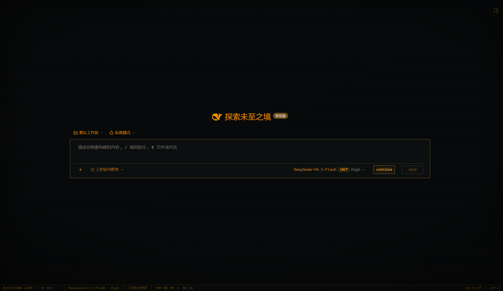
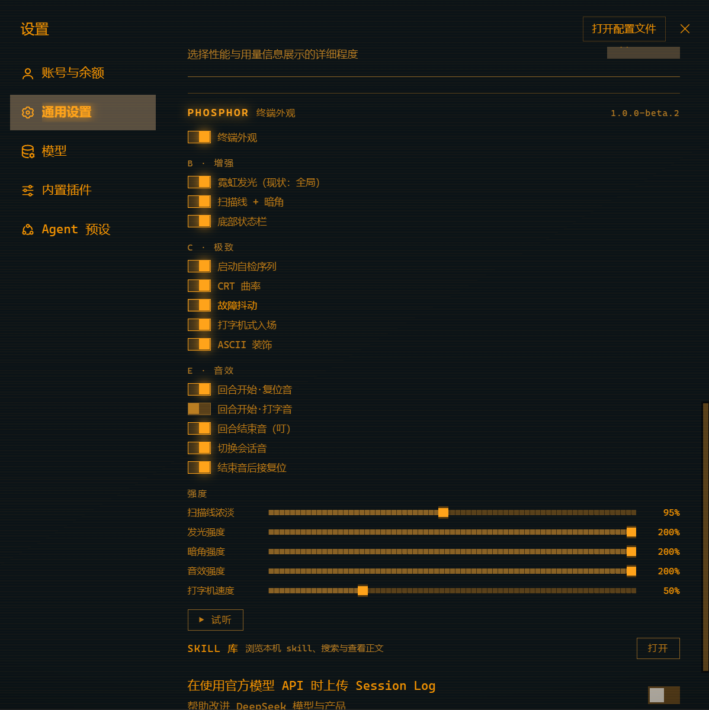

# DSH // PHOSPHOR

> 黑底磷光绿的黑客终端主题，给 DSH（DeepSeek Harness）用。

等宽字体、霓虹激活态、扫描线 + 暗角、CRT 曲率、故障抖动、打字机式入场、
底部常驻终端状态栏，**随回合推进的听觉反馈**（复位音 → 打字音 → 结束叮），
外加一套藏起来的实验室、三档磷光粉配色、一台能玩的街机。

> **当前版本 `1.0.0-beta.2`**（测试版）。设置面板里显示的也是这一串 —— 报问题时请带上它。





```
  PHOSPHOR BIOS 1.0.0-beta.2
  cpu ......... deepseek-flash
  theme ....... 14 alias tokens bound
  font ........ JetBrains Mono
  fx .......... scanline / vignette / glow
  ▌
```

> 上面是主题启动时真实打印的自检文字（截取前几行）。


---

## 它做了什么

| 类别 | 内容 |
|---|---|
| **外观** | 等宽字体 · 霓虹发光 · 扫描线 + 暗角 · CRT 曲率 · 故障抖动 · 打字机式入场 · ASCII 装饰 · 方角化与调色板替换 |
| **状态栏** | 底部常驻终端条：会话态 · 模型 · 访问模式 · 余额 · 最高分 · 时钟 |
| **音效** | 四段声音挂在三个时机：回合开始 / 回合结束 / 切换会话 |
| **磷光色** | P1 绿（默认）· P3 琥珀 · P4 白 —— 老式单色显示器的三种真实荧光粉 |
| **电源效果** | 开关总闸时播放 CRT 关机（压线 → 缩点）与开机动画 |
| **SKILL 库** | 设置面板里直接浏览本机 skill：搜索、看正文、在资源管理器打开 |
| **隐藏内容** | 一间实验室、一台街机。入口都藏在界面上 —— **自己找 🙂** |

所有装饰都可单独关闭；**关掉总闸后不留任何残余**（令牌、内联变量、DOM 节点三层一起撤）。

---

## 安装

这个主题是一个 DSH **bundle**（不是一个可以手放的 CSS 文件）。

> **关于包名**：`@local/dsh-phosphor` 是它的安装标识 —— `@local` 表示"从本地路径安装、
> 不走 registry"，并不代表它只在本机可用。**你在设置里看到的名字是「PHOSPHOR 磷光绿」**，
> 那才是用户可见的名称，与包名无关。

```bash
git clone <这个仓库> dsh-phosphor
```

然后**让你的 DSH agent 装它**（把绝对路径给它）：

> 把这个 bundle 装到当前 profile：`<克隆下来的绝对路径>`

对应的是 `plugin_manager` 的 `action: install_bundle`、`target: <路径>`。
安装工具会自己处理依赖、包链接与 profile 的 patch，**不要手工改 profile 的 `package.json`**。

**装完必须重启 DSH**（主题在应用启动时装载，刷新页面不够）。

> 如果你拿到的是压缩包（测试版分发方式），包里的 **`QUICKSTART.txt`** 是给「从没装过插件的人」的一页说明，内容与上面一致。

### 怎么确认装上了

**设置 → 通用**，往下找 **「PHOSPHOR 磷光绿」** 那一行。

- 看得到 → 装好了
- 看不到 → 多半是没重启，或者安装报告里有 `restart-required` / `failed`

### 卸载

```text
plugin_manager · action: remove_bundle · target: @local/dsh-phosphor
```
## 设置面板

分组如下，**全部实时生效**：

| 组 | 项 |
|---|---|
| **总闸** | 终端外观 —— 关掉即整套停用，不留残余 |
| **B · 增强** | 霓虹发光 · 扫描线 + 暗角 · 底部状态栏 |
| **C · 极致** | 启动自检序列 · CRT 曲率 · 故障抖动 · 打字机式入场 · ASCII 装饰 |
| **E · 音效** | 回合开始·复位音 · 回合开始·打字音 · 回合结束·叮 · 结束音后接复位 · 切换会话音 |
| **强度** | 扫描线浓淡 · 发光强度 · 暗角强度 · 音效强度 · 打字机速度 |

**音效强度是全局乘数**（0 = 静音、100 = 基准、200 = 两倍），乘在每组增益之上，
所以**不改变各音之间的相对配比**。

### LAB（实验室）

某个地方可以连点三下展开（猜猜在哪里~），**默认收起** —— 没发现它时，面板和普通主题完全一样。

里面目前有：磷光色三档、开关机动画开关、彩蛋总开关，以及一份 **SYSTEM LOG** ——
记录你在这台"机器"上做过的事。未解锁的条目显示成等宽红块，**长度就是原文**。

---

## 磷光色 P1 / P3 / P4

PHOSPHOR 这个名字来自**磷光粉**，而它真实存在三种：**P1 绿、P3 琥珀、P4 白**。
LAB 里可以切换。

实现上是**色相变换**，不是三套手写色板 —— 三种色调因此天然继承同一套层级关系。
**P1 是恒等变换**：选它就完全走原始路径，一个字节都不变。

三种配色在深色底上的正文对比度实测分别为 **10.8:1 / 8.8:1 / 8.8:1**（WCAG 要求 ≥4.5）。

---

## 音效

**四段声音，三个时机**：

| 时机 | 声音 |
|---|---|
| 一轮**开始** | 复位长音（随后随内容到达出打字声） |
| 一轮**结束** | 「叮」，随后接一段复位尾音 |
| **切换会话** | 单次「咔」 |

三个刻意的设计：

1. **打字声不会变成机关枪** —— 两道门：内容到达触发 + 不完全重叠的节流。
   「打字机速度」滑块调的是**节流参数**，不是播放速率。
2. **结束时的复位尾音会淡出** —— 否则它会盖住下一轮的打字声。
3. **共享限幅总线** —— 多声重叠不削波。

### ⚠️ 第一次可能没声音

浏览器的自动播放策略要求**先与页面交互过**（点一下任意位置）才允许创建 `AudioContext`。
**这是浏览器行为，不是 bug。** 设置面板里的 **「▶ 试听」** 是自检入口 ——
悬停它会显示当前音频状态。

---

## 已知限制

| 限制 | 说明 |
|---|---|
| **必须重启** | 主题在应用启动时装载；改代码后刷新页面不够 |
| **必须先点一下页面** | 浏览器自动播放策略，见上 |
| **依赖宿主的类名哈希** | 「切换会话音」靠会话行上的稳定哈希类名判断选中项；宿主改版可能影响它 |
| **`client.js` 约 780 KB** | 其中约六成（实测 61.6%）是内嵌的四段音频。换来**零配置、零外部请求、完全离线** |
| **LAB 与系统日志只有中文** | 设置面板的文案跟随宿主语言（有 en / zh 两份词典）；但 LAB、系统日志与街机的文案是中文语感写死的，未做翻译 |
## 许可

**MIT** —— 见 [LICENSE](LICENSE)。

仓库内嵌的**音频素材亦为 MIT**（原创）。

---

## 致谢

大部分代码是 **DeepSeek-V4.1-Flash** 写的，我只做了一些微小的工作 ——
比如决定它该长什么样、在它写错的时候说「不对」、以及把它测到真的能跑。
（← 这也是 DeepSeek-V4.1-Flash 加上去的）

外层框架（bundle 形态、Client/Host 半边、slot 注册）来自 DSH 官方的 decoration 模板。